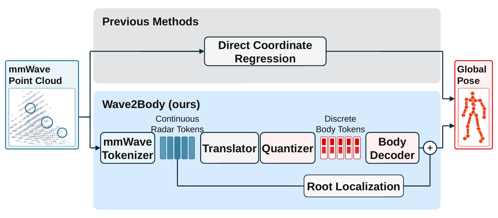

# Wave2Body

Official implementation of **Wave2Body**, a token-based framework for
radar-frame 3D human pose estimation from mmWave point clouds.

Wave2Body learns three interfaces:

1. a self-supervised mmWave patch tokenizer;
2. a body-part pose tokenizer;
3. a radar-to-body token translator followed by an absolute localization head.



*Wave2Body reformulates mmWave HPE from direct coordinate regression to
radar-to-body token translation. The body encoder used to construct training
targets is omitted here; see the paper for the complete training recipe.*

This repository contains the reusable package, training and evaluation
launchers, paper configurations, baseline ports, ablations, and visualization
code. Checkpoints, datasets, caches, and generated experiment outputs are kept
outside Git.

## Installation

Wave2Body is tested with Python 3.10, PyTorch 2.5, and CUDA 12.4.

```bash
uv sync --group dev
```

Run commands with `uv run python ...`. The core implementation uses a PyTorch
FPS fallback and does not require a custom point-cloud extension.

## Datasets

The paper uses M4Human, mmBody, and AMASS. Obtain each dataset from its
official distributor and follow its license. M4Human SMPL-X decoding also
requires the licensed male and female SMPL-X model files.

Copy the path template and replace every empty value:

```bash
cp configs/dataset_paths.example.yaml configs/dataset_paths.local.yaml
export WAVE2BODY_DATASET_PATHS="$PWD/configs/dataset_paths.local.yaml"
```

The expected logical aliases are:

```yaml
datasets:
  m4human: /path/to/m4human
  mmbody: /path/to/mmbody
  amass_preproc: /path/to/amass/preprocessed
  amass_all_motions: /path/to/amass/all_motions_fps60.pkl
```

To build the compact mmBody representation used by the release:

```bash
uv run python scripts/datasets/compact_mmbody.py --help
uv run python scripts/datasets/validate_mmbody_compact.py --help
```

## Pretrained weights

Google Drive: [download]()

The link is intentionally empty for the initial repository upload and will be
filled with the public checkpoint bundle. Preserve the bundle directory layout
when extracting it:

```text
wave2body_workspace/
├── vqvae/
│   └── checkpoints/
└── wave2body_artifacts/
    └── experiments/
```

Then set:

```bash
export WAVE2BODY_WORKSPACE_ROOT=/path/to/wave2body_workspace
export WAVE2BODY_ARTIFACT_ROOT="$WAVE2BODY_WORKSPACE_ROOT/wave2body_artifacts"
```

Every CLI accepts explicit checkpoint overrides, so the archive layout is
convenient rather than mandatory.

## Quick checks

```bash
uv run python -m pytest -q
uv run python scripts/mmwave_tokenizer/train.py --config m4human_s2_trainonly --dry-run
uv run python scripts/hpe_token/train.py --config m4human_stage1_s2 --dry-run
uv run python scripts/hpe_token/train.py --config m4human_abs_s2 --dry-run
uv run python scripts/hpe_baselines/train.py --config mmdiff_m4human_s2 --dry-run
```

## Reproducing the paper

### Evaluation protocol

- M4Human Cross-Subject uses split `s2` and Cross-Action uses split `s3`.
- M4Human semantic groups are actions 1--30 (In-Place), 31--35
  (Sit-In-Place), and 36--50 (Non-In-Place).
- The micro average is computed over all test samples, not by averaging the
  three action-group means.
- mmBody uses held-out training sequences for validation and the official test
  set for one final evaluation.
- Learned main-table entries use seeds 42, 43, and 44 and report mean plus or
  minus the sample standard deviation.
- Component ablations use seed 42.
- Checkpoints are selected by validation metrics; test metrics are never used
  for model selection.
- All reported pose errors are radar-frame millimeters.

### Evaluate Wave2Body checkpoints

Evaluate each of the three Stage-II checkpoints. Replace the checkpoint and
output placeholders with the extracted archive paths.

```bash
uv run python scripts/hpe_token/evaluate.py \
  --config m4human_abs_s2 \
  --checkpoint /path/to/s2_seed42/best.pth \
  --eval-split test \
  --per-action \
  --output outputs/wave2body_s2_seed42.json

uv run python scripts/hpe_token/evaluate.py \
  --config m4human_abs_s3 \
  --checkpoint /path/to/s3_seed42/best.pth \
  --eval-split test \
  --per-action \
  --output outputs/wave2body_s3_seed42.json

uv run python scripts/hpe_token/evaluate.py \
  --config mmbody_abs \
  --checkpoint /path/to/mmbody_seed42/best.pth \
  --eval-split test \
  --no-action-groups \
  --output outputs/wave2body_mmbody_seed42.json
```

Repeat with seeds 43 and 44. These JSON files contain absolute MPJPE, root
error, root-aligned MPJPE, Procrustes-aligned MPJPE when enabled, action-group
metrics, and per-joint metrics.

The expected main-table micro averages are:

| Dataset / protocol | Wave2Body | WiCompass | mmMesh | mmDiff |
| --- | ---: | ---: | ---: | ---: |
| M4Human Cross-Subject | 102.53 ± 0.29 | 113.53 ± 1.91 | 146.10 ± 2.46 | 149.42 ± 5.32 |
| M4Human Cross-Action | 115.26 ± 0.98 | 119.81 ± 4.36 | 150.34 ± 1.03 | 161.64 ± 4.55 |
| mmBody official test | 128.17 ± 1.87 | 139.69 ± 4.43 | 145.79 ± 2.91 | 267.37 ± 19.36 |

RT-Mesh values in the paper are transcribed from the official M4Human report;
RT-Mesh is not trained by this repository.

### Train Wave2Body from scratch

The dependency order is mmWave tokenizer, body tokenizer, Stage-I translator,
then Stage-II translator plus localization.

#### 1. mmWave tokenizers

```bash
uv run python scripts/mmwave_tokenizer/train.py \
  --config m4human_s2_trainonly --device cuda --gpus 0
uv run python scripts/mmwave_tokenizer/train.py \
  --config m4human_s3_trainonly --device cuda --gpus 0
uv run python scripts/mmwave_tokenizer/train.py \
  --config mmbody_sota --device cuda --gpus 0
```

The paper model uses 96 FPS centers, 32 nearest neighbors per patch, 128-D
radar tokens, 60% masking, and 80 pretraining epochs.

#### 2. Body tokenizers

```bash
uv run python scripts/human_pose_tokenizer/train.py \
  --config wave2body/configs/human_pose_tokenizer/stage_a_part_k96_amass_m4human_s2_trainonly_param_joints.yaml \
  --gpus 0
uv run python scripts/human_pose_tokenizer/train.py \
  --config wave2body/configs/human_pose_tokenizer/stage_a_part_k96_amass_m4human_s3_trainonly_param_joints.yaml \
  --gpus 0
uv run python scripts/human_pose_tokenizer/train.py \
  --config mmbody_train_pretrain --gpus 0
uv run python scripts/human_pose_tokenizer/train.py \
  --config mmbody_train_finetune --gpus 0
```

The body tokenizer uses 24 latent slots across five body regions, 256-D
embeddings, 96 codes per region, and 30 epochs.

Evaluate body reconstruction with:

```bash
uv run python scripts/human_pose_tokenizer/evaluate_reconstruction.py --help
uv run python scripts/human_pose_tokenizer/evaluate_training_val.py --help
```

#### 3. Stage-I and Stage-II HPE

For each split and seed, first train Stage I, then pass its best checkpoint to
Stage II:

```bash
uv run python scripts/hpe_token/train.py \
  --config m4human_stage1_s2 --seed 42 --device cuda --gpus 0

uv run python scripts/hpe_token/train.py \
  --config m4human_abs_s2 --seed 42 \
  --hpe-token-checkpoint /path/to/stage1_seed42/best.pth \
  --device cuda --gpus 0
```

Repeat for seeds 43 and 44, replace `s2` with `s3` for Cross-Action, and use
`mmbody_stage1` plus `mmbody_abs` for mmBody.

### Reproduce baseline results

PointTransformer/WiCompass:

```bash
uv run python scripts/hpe_point_transformer/train.py \
  --config m4human_absolute_hist4 --split-id s2 \
  --seed 42 --batch-size 48 --device cuda --gpus 0
uv run python scripts/hpe_point_transformer/train.py \
  --config m4human_absolute_hist4 --split-id s3 \
  --seed 42 --batch-size 64 --device cuda --gpus 0
uv run python scripts/hpe_point_transformer/train.py \
  --config mmbody_noinput_absolute_fastcache \
  --seed 42 --batch-size 128 --device cuda --gpus 0
```

mmMesh and mmDiff:

```bash
uv run python scripts/hpe_baselines/train.py \
  --config mmmesh_m4human_s2 --seed 42 --device cuda --gpus 0
uv run python scripts/hpe_baselines/train.py \
  --config mmmesh_m4human_s3 --seed 42 --device cuda --gpus 0
uv run python scripts/hpe_baselines/train.py \
  --config mmdiff_m4human_s2 --seed 42 --device cuda --gpus 0
uv run python scripts/hpe_baselines/train.py \
  --config mmdiff_m4human_s3 --seed 42 --device cuda --gpus 0
uv run python scripts/hpe_baselines/train.py \
  --config mmmesh_mmbody --seed 42 --device cuda --gpus 0
uv run python scripts/hpe_baselines/train.py \
  --config mmdiff_mmbody --seed 42 --device cuda --gpus 0
```

Repeat every learned baseline with seeds 43 and 44. The training pipeline
writes validation-selected checkpoints and final test metrics to its run
directory. The M4Human-specific evaluator scripts provide action-group retests
for mmMesh and mmDiff.

### Component ablations

Run `scripts/ablation_components/train.py` with seed 42. The paper variants map
to the following configuration prefixes:

| Paper variant | Configuration |
| --- | --- |
| w/o body tokenizer | `no_body_token_relative_root_m4human_{s2,s3}_trainonly_tokenizers.yaml` |
| M4Human-only body prior | `m4human_trainonly_body_{hpe,absolute}_m4human_{s2,s3}.yaml` |
| w/o mmWave tokenizer | `no_radar_tokenizer_{hpe,absolute}_m4human_{s2,s3}_trainonly_tokenizers.yaml` |
| AMASS-only body prior | `amass_only_body_{hpe,absolute}_m4human_{s2,s3}_trainonly_tokenizers.yaml` |

Example:

```bash
uv run python scripts/ablation_components/train.py \
  --config no_radar_tokenizer_hpe_m4human_s2_trainonly_tokenizers \
  --device cuda --gpus 0

uv run python scripts/ablation_components/train.py \
  --config no_radar_tokenizer_absolute_m4human_s2_trainonly_tokenizers \
  --hpe-token-checkpoint /path/to/ablation_stage1/best.pth \
  --device cuda --gpus 0
```

Aggregate action-group JSON files with:

```bash
uv run python scripts/ablation_components/summarize.py \
  --entry Cross-Subject,variant_name,/path/to/metrics.json \
  --entry Cross-Action,variant_name,/path/to/metrics.json \
  --output-csv outputs/component_ablation.csv \
  --output-json outputs/component_ablation.json
```

Expected seed-42 micro-average absolute MPJPE:

| Variant | Cross-Subject | Cross-Action |
| --- | ---: | ---: |
| w/o body tokenizer | 128.25 | 134.60 |
| M4Human-only body prior | 103.68 | 114.06 |
| w/o mmWave tokenizer | 130.51 | 137.52 |
| AMASS-only body prior | 103.46 | 115.08 |
| Full Wave2Body | 102.67 | 115.23 |

### Stage-I token alignment

Run the translator-only checkpoints with `--token-alignment`:

```bash
uv run python scripts/hpe_token/evaluate.py \
  --config m4human_stage1_s2 \
  --checkpoint /path/to/stage1_s2_seed42/best.pth \
  --eval-split test \
  --token-alignment \
  --output outputs/stage1_alignment_s2_seed42.json
```

Repeat over S2/S3 and seeds 42/43/44. Plot an aggregated summary with:

```bash
uv run python scripts/visualization/plot_stage1_token_alignment.py --help
```

The paper reports paired token-ID agreement of 22.63% on Cross-Subject and
21.60% on Cross-Action. Same-action/other-subject controls are 14.68% and
12.49%; other-action/same-subject controls are 12.25% and 10.80%.

### Efficiency

The reported efficiency experiment uses one RTX 4090, bf16, TF32, PyTorch
eager execution, no `torch.compile`, training batch size 192 for Wave2Body and
48 for PointTransformer, and inference batch size 192.

```bash
uv run python scripts/efficiency/run_m4human_efficiency.py \
  --preset m4human_s2_current \
  --gpus 0 \
  --profile-batches 128
```

Expected profiler results:

| Method | Training PFLOPs | Parameters | GFLOPs/sample | Throughput | Peak memory |
| --- | ---: | ---: | ---: | ---: | ---: |
| WiCompass | 2309.408 | 26.91 M | 62.381 | 536.6 samples/s | 7556.4 MiB |
| Wave2Body | 74.495 | 16.93 M | 0.6946 | 4328.5 samples/s | 558.9 MiB |

Throughput and memory are hardware- and software-stack-dependent; parameters
and supported-operation FLOPs should remain stable.

### Qualitative and diagnostic figures

- `scripts/visualization/error_bucket_pose_figure.py` selects and renders the
  qualitative low-to-high error examples.
- `scripts/visualization/render_m4human_abs_samples.py` renders Wave2Body
  predictions.
- `scripts/visualization/render_m4human_wicompass_comparison.py` renders the
  matched-baseline comparison.
- `--per-action` and the default full evaluation metrics reproduce the
  action-group, error-decomposition, and per-joint source values.
- `scripts/visualization/plot_stage1_token_alignment.py` reproduces the Stage-I
  selectivity figure after aggregating the three seeds.

Use `--help` on each visualization entrypoint for its input manifest and output
arguments.

## Reproducibility notes

The released configurations restrict all M4Human tokenizer pretraining to the
matching training split. Do not replace them with an all-split diagnostic
tokenizer.

Archived checkpoints reproduce the reported evaluator outputs. Historical
training runs were created during active development, so exact bit-for-bit
replay is not guaranteed; from-scratch runs should be compared as three-seed
statistics under the documented protocol.

## License

Code is released under the MIT License. Dataset, SMPL-X, AMASS, and third-party
baseline assets retain their original licenses.
